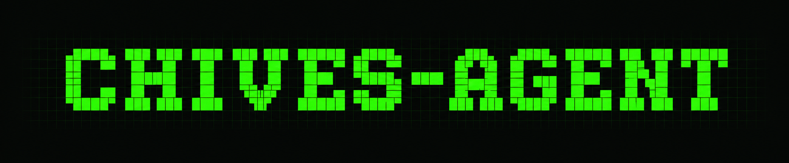
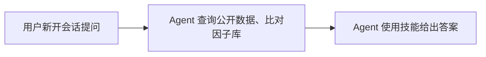
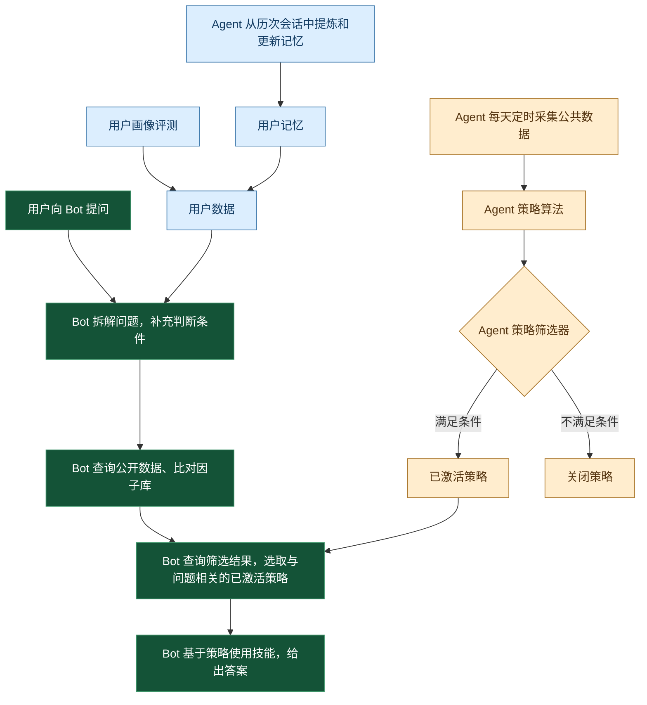

<p align="center">
  
</p>

<h1 align="center"> 老韭菜 · Chives</h1>

<p align="center"><strong>面向 A 股的本地 AI 投研平台</strong></p>

<p align="center">
  <a href="#为什么选-chives">为什么选 Chives</a> ·
  <a href="#chives-的努力方向">努力方向</a> ·
  <a href="#如何使用-chives">快速安装</a> ·
  <a href="INSTALL.md">安装文档</a> ·
  <a href="#共创">加入共创</a>
</p>

## 为什么选 Chives

这个项目的中文名是「老韭菜」，英文名是 Chives，由 [@xionglaoshi](https://github.com/xionglaoshi) 和 [@shihaoxiong](https://github.com/shihaoxiong) 共同构建。它从 Midas 的工程基线演进而来。两个姊妹产品各有侧重，分别探索不同的技术路线和投资策略，未来正式发布的产品可能结合两边的长处。 [Midas 仓库](https://github.com/shihaoxiong/midas)

**你是不是也有这些痛点？** 你问股票 AI：「这只股票我已经亏了两成，还该继续拿吗？」它从基本面讲到均线和估值，头头是道，末了劝你「谨慎持有，最好再咨询专业顾问」。你随口说一句「我倒挺看好它下半年的表现」，它就可能打开「鼓吹模式」，把估值修复、订单回暖、新品放量一条条列给你。你反问「既然这么好，为什么一直不涨」，它又把同一家公司的利空讲得有鼻子有眼，听得你觉得今天不卖，明天就要爆雷。聊了半天，你连它自己更相信哪种判断都摸不准，怎么放心拿真金白银照着做？

拿同一份财报里的同一个数试试。假设期末库存比去年同期高了三成，你问「这说明什么」，它可能说「公司在为旺季备货」。你只追问一句「你确定吗」，它又可能改口说「需求疲软，货积在仓库里卖不动」。库存还是那个数，中间连一张新订单都没看到。今天的大语言模型按概率生成回答，离能自己弄清这家企业生意的通用人工智能（AGI）还有距离。上下文和你的语气一变，听起来最顺的解释也会跟着变。把它当研究工具，我更希望它接着查两件事：这多出来的库存里，有多少对应已签订单？旺季过后，这批货是按原价卖出去了，还是打折也没人要？这些证据才值得让人改主意。

在我们用过的股票 AI 产品里，绝大部分走的是「模型＋技能＋因子库」路线。查数、算因子、找相似走势都很快，难处在于判断这些经验**今天还适不适用**。同样是放量上涨，牛市里可能是资金追着全行业买，在熊市里却可能只是一次短暂回补。同样是库存上升，造船厂可能是在为已签订单备料，消费品公司却可能是货卖不动了。只看同一个因子的高低，很容易把两门生意读成同一个故事。

更让人犯难的是，买入时的理由可能已经变了。上次看好一家出口企业，是因为订单增长。后来海外利率上升、客户推迟交货，AI 再读那份漂亮的年报，还会重复上次的结论吗？散户真正需要的是有人记得当初为什么买，知道今天该核哪项数据，也能说清哪条证据出现后就该改主意。

**用的还是同一个模型，凭什么换成 Chives，判断就能更稳？** 我们走「策略＋Bot」路线，是想给模型一把做研究的尺子。下图第一条流程里，AI 查到库存涨了三成，就要回答「你怎么看」。挑哪条经验、这条经验今天还适不适用，都留给模型在回答时决定。Chives 把其中一步提前了。研究员先把方法写成规则，规定查哪些数、按什么口径算、满足什么条件才允许引用这条策略。等你来问，Bot 手里已经有一个可以复算的「是」或「否」。

**这把尺子怎么用？** Chives 的策略设计比下面的例子复杂得多。为了说清什么是策略、它在什么条件下才会启用，我们拿库存打个比方，只看一个条件。假设一家按订单生产的设备厂，多出了 100 台同型号成品。我们约定，如果至少 80 台能逐台对应到有效、尚待交付的客户订单，就激活「按订单备货」策略。核到 85 台，开关打开，Bot 可以沿着备货这条线查客户什么时候提货、交付后多久回款。若公告披露其中 20 台的订单已取消，覆盖数降到 65 台，开关就关闭。若公司根本没披露对应关系，Bot 只能把订单覆盖列为待核，连「库存积压」也得另找证据。这里的 80 台仅用于演示触发条件。

下图橙色部分就是这道开关。按设计，Agent 每天更新公开数据，策略算法按同一口径计算，筛选器记录哪些策略激活、哪些关闭。**同一批数据、同一版规则，算出来的开关状态就该相同。** 你追问十次「确定吗」，85 台还是 85 台。能改变判断的是新订单、撤单公告，或者一项说得清缘由的规则修订。

蓝色部分让 Bot 记得你当初为什么买、这笔钱什么时候要用。绿色主线把两件事接起来：Bot 先弄清你问的是公司备货是否合理，还是自己的仓位能不能再等半年，然后查数、选用已激活的策略，给出针对你的意见。两个人的持有期限可以不同，对那 85 台设备的认定应当一致。

我们已经构思了上百项策略，接下来会逐步录入和验证。开关可以算得一致，这把尺子准不准，还得拿结果来验。我们希望找到在特定条件下经得起检验、判断准确率有望达到 80% 以上的规律，错判也要留在样本外和实战记录里。

### 为什么Chives的判断能更准确

**竞品模式：模型+技能+因子库**



**Chives：策略+Bot**



Chives 的设计里有两套不同的时间表。市场每天都在变，Agent 定时采集公共数据，按行业、阈值和有效期重新计算每项策略的开关。等你来提问，Bot 先结合你的用户画像和历史会话弄清楚要解决什么问题，再从已经激活的策略里挑出适用的，说明它为什么命中、什么变化会让它失效。策略市场已预留入口，完整触发链和首批规则将逐步接入验证。

### 同一条策略已经激活，为什么还需要不同的 Bot？

回到那家设备厂。新增的 100 台成品里，已核实有 85 台对应有效订单，「按订单备货」策略已经激活。两位 Bot 从同一个事实出发，接下来各自会翻哪份材料？我们以 **30 余位投资人**为研究样本，把他们公开的方法拆成可操作的研究问题。下面是两种模拟的问法。

**巴菲特式的 Bot 会问：「做完这 85 台，股东手里能留下多少钱？明年再接一批同样的单子，还得往厂里投多少钱？」** 它会先翻付款条款，看签单时客户预付几成、验收后多久付尾款，再查往年同类订单实际用了多久才收回钱。接着翻在建工程和设备投资公告，看现有产线就能交货，还是得为这批生意新建一条线。要是利润看着不错，客户却要两年才付清，公司又得先掏钱扩产，它就会重新算一遍，这批订单占用的资金到底能挣回多少。

**段永平式的 Bot 会问：「客户为什么挑这款设备？下次扩产，还会来找这家厂吗？」** 它会找同一客户前后两次的招标文件和中标结果，看客户最看重良率、停机时间还是价格，再核对老客户有没有按相近的价格复购。假如公司说产品好用、客户离不开它，公开资料却只查到一次大幅降价中标，它会把「客户愿意为产品多付钱」留作待核，继续找使用和复购的证据。

把两份答复放在一起，可能会看到一门值得细看的生意：老客户愿意按原价再买，说明产品有吸引力；可要是每多卖一批就得垫两年货款，订单越多，现金反而越紧。策略开关让两个 Bot 对这 85 台设备有共同的判断起点，不同的研究方法让你同时看清**客户为什么愿意买，以及这门生意值不值得股东继续投钱**。

### 同一张报表，两种判断

假设一家设备厂收入和利润双增，经营现金流转正，同期应收也在增加。下面是两种研究流程的对照，结论取决于后续证据。

| 研究环节 | 模型＋技能＋因子库 | Chives 的策略＋Bot 路线 |
| --- | --- | --- |
| 看市场 | 查估值分位和同业数据，模型自行判断外部环境的重要性 | 先查全球利率、A 股牛熊环境和政策变化，再判断哪些规则可激活 |
| 看行业和公司 | 读利润、现金流和应收，生成盈利质量研判 | 按设备行业的验收、回款周期和公司所处阶段，找订单、付款与应收账龄的证据 |
| 形成意见 | 结论容易跟着财报里最显眼的几项指标走 | 订单和实际回款同步改善时，可以按扩产情景研究。若现金转正主要靠延付供应商款，且客户回款放慢，就要转向核查现金和信用风险 |

即使模型和财报完全相同，前一种情形下 Bot 可能建议继续研究这个买点，后一种情形下可能建议暂缓。公告只披露了审计抽查、找不到期后实收金额时，Bot 应把回款列为待核。

## Chives 的努力方向

1. **让策略跟得上市场。** 持续更新策略库、触发器数据库和条件算法。用历史时点实际可得的数据复算，记录命中、失效、错判和数据缺口。
2. **让 Bot 越来越像知名投资人。** 把研究问题、证据标准和反例写进 Bot 的方法，随着模型、数据和工具进步反复对照这些投资人处理实际问题时的思考过程。

我们想用实战检验 **三个 80%**。这些是开发目标，目前没有经过验证的达标数据。

| 目标 | 怎么检验 |
| --- | --- |
| **80% 的个股分析判断正确** | 分项复核基本面、盘口、合理估值、风险提示和行业前景 |
| **80% 的个股交易建议正确** | 事前记录买入、卖出、持有的价格条件和观察期限，按约定纳入交易成本与基准 |
| **80% 的大盘中短期走势判断正确** | 事前固定指数、期限和涨跌判断口径，保留所有预测，到期统一核对 |

## 为什么创建 Chives

*[@xionglaoshi](https://github.com/xionglaoshi)*

我以前在私募基金工作过，后来被股市折磨得自我淘汰，转去做实业了。可每回看到一家有意思的公司，手还是会顺着去翻财报。

2026 年初开始自学 Agent，能折腾的产品基本折腾了一遍。7 月开始关注股票垂直领域的 AI，也花钱买来用了。问几个大而泛之的问题，看起来像那么回事。可真要拿自己的钱按它的意见买入，读完还是心里没底。凭我的使用体验，80 分差不多就是上限。它有点像刚入行两三年的研究员，报告写得快，遇到例外还不知道该去核哪一笔账。

- **同样是两成毛利率，两家设备厂值一样多吗？** 一家卖完机器就结束，另一家还有持续多年的维保收入。要知道后者值不值得给更高估值，就得查已装机数量、续约率和服务费，再看维保收入要垫多少应收。报表上的毛利率只能告诉我从哪里开始看。
- **同样是回购，公司为什么偏在这个时候买？** 一家公司手里有现金，股价又低，回购可能是划算的资本配置。另一家公司刚借了钱，还要在半年内偿还大额债务。即使公告里的回购比例一样，我也会先看它的钱从哪儿来、回购完还剩多少。
- **八倍市盈率，是真便宜还是赶上利润最高的一年？** 材料厂刚交出历史最好的年报，明年若遇到同行集中投产，产品一降价，利润可能减半。同样的股价就成了十六倍。我要跟踪产线实际进度、客户库存和订单，才能判断八倍到底代表什么。
- **推荐的股票涨了，判断就对了吗？** 牛市里跟着大盘涨并不稀奇。我更想看，同一段时间相对行业或指数赚了多少，以及当初写进报告里的订单、提价或回款，后来到底有没有发生。

我懂一点股票，也懂一点 Agent，就想试试自己做一款能打到 120 分的产品。想明白为什么模型很强，遇到这些问题却还是容易看走眼，才慢慢有了「策略＋Bot」的构想。我想要的 120 分，是让普通股民也能做过去要靠一个团队才能做细的研究。三个 80% 能不能做到，要用实战说话。

## 如何使用 Chives

Chives 目前没有商业化计划。我们把它作为公开源码、供个人使用的公益项目。你可以装在自己的电脑上，接入自己购买或已有权限的模型。将来如果为了做准策略，需要购买第三方财务数据库或承担较高的算力开销，我们可能考虑接受赞助或适度收费来分摊成本。

### 快速安装

下面是仓库内的三端安装向导。向导需要有效安装码和可用的分发服务，安装完成后会启动工作台。Linux 和 Windows 的实机验证仍待补齐。macOS 也可按详细文档从公开源码安装。 [详细安装文档](INSTALL.md)

**macOS**

```bash
tmp="$(mktemp)" && curl -fsSL https://raw.githubusercontent.com/xionglaoshi/chives/main/deploy/installer/macos.sh -o "$tmp" && bash "$tmp"
```

**Linux**

```bash
tmp="$(mktemp)" && curl -fsSL https://raw.githubusercontent.com/xionglaoshi/chives/main/deploy/installer/linux.sh -o "$tmp" && bash "$tmp"
```

**Windows · PowerShell**

```powershell
$p = [IO.Path]::Combine([IO.Path]::GetTempPath(), ([Guid]::NewGuid().ToString() + '.ps1')); Invoke-WebRequest -UseBasicParsing -ErrorAction Stop https://raw.githubusercontent.com/xionglaoshi/chives/main/deploy/installer/windows.ps1 -OutFile $p; powershell -NoProfile -ExecutionPolicy Bypass -File $p
```

### 第一次打开

1. **启动。** 安装完成后，在新终端输入 `chives`，本地服务就绪后会自动在默认浏览器打开工作台。再次输入可重新打开页面，输入 `chives stop` 可关闭本地服务。 [本地工作台 127.0.0.1:8888](http://127.0.0.1:8888/)
2. **添加模型。** 到「设置 → 模型设置」，填写自己的连接，验证后设为默认。
3. **先做一次风格评估。** 从工作台打开「风格评估」，完成问卷，生成初始用户画像。相同的股票和价格，对需要随时用钱的人与能承受几年波动的人，合适的建议可能不同。Bot 会参考你的资金安排、风险承受能力和投资偏好。以后可以根据实际交易和想法更新用户画像。
4. **问一个手里有资料的问题。** 例如「请把这家公司近两期的归母净利润、销售收现和应收账龄列在一起，给出公告出处，并告诉我还要核什么」。先用自己熟悉的公司看看回答能不能复核。

## 共创

我们都有自己的工作，Chives 是闲下来才做的测试产品，还有不少地方没想透。就我自己来说，离开专业投资机构这么久，以前本来就是半桶水，现在恐怕连十分之一桶都没有了。

如果你认同「策略＋Bot」这条路，也希望普通股民能用上更扎实的投研方法，欢迎扫码加入开发讨论群。带一个你熟悉的行业问题、几条可以公开核实的证据，或者一个能把现有规则推翻的反例来。我们一起把策略写清楚，把 Bot 做得像真正懂这门生意的人。 [GitHub 问题与建议](https://github.com/xionglaoshi/chives/issues)

<p align="center">
  
  <br><sub>微信扫码加入 Chives 开发讨论群</sub>
</p>

## 许可证

Chives 的原创代码、策略与触发器、因子实现、Bot 设定、提示词、脚本和榜单算法采用 **PolyForm Noncommercial License 1.0.0**。个人可按许可条款用于非商业学习、研究和实验。商业部署、收费分发或将这些原创资产用于商业产品，须另获作者许可。第三方代码、数据及素材沿用各自的许可与授权。 [许可全文](LICENSE) · [第三方声明](THIRD_PARTY_NOTICES.md)
