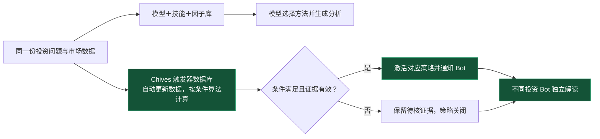

<p align="center">
  
</p>

<h1 align="center">老韭菜 · Chives</h1>

<p align="center"><strong>面向 A 股的本地 AI 投研平台</strong></p>

<p align="center">
  <a href="#为什么选-chives">为什么选 Chives</a> ·
  <a href="#chives-的努力方向">努力方向</a> ·
  <a href="#如何使用-chives">快速安装</a> ·
  <a href="INSTALL.md">安装文档</a> ·
  <a href="#共创">加入共创</a>
</p>

## 为什么选 Chives

Chives 由熊翔（[@xionglaoshi](https://github.com/xionglaoshi)）和熊世豪（[@shihaoxiong](https://github.com/shihaoxiong)）共同构建。它从 Midas 的工程基线演进而来。两个姊妹产品各有侧重，分别探索不同的技术路线和投资策略，未来正式发布的产品可能结合两边的长处。 [Midas 仓库](https://github.com/shihaoxiong/midas)

**同一家公司、同一张财报，换一个市场环境，投资判断可能就得重做。** 「模型＋技能＋因子库」擅长查资料、做计算和批量筛选。到了散户真正关心的那一步，比如能不能买、什么价格买、该不该继续拿，模型还得知道眼下哪套方法适用。全球利率、国内政策、行业周期、公司所处阶段，任何一项变化都可能改变答案。

Chives 走的是 **策略＋Bot** 路线。我们已经构思了上百项策略，会逐步录入、验证和发布。每项策略要写明它回答什么问题、在什么情况下适用、什么证据会推翻它。希望找到的是在特定条件下大多数时候成立、经验证有望达到 80% 以上的规律。每次触发都保留失效条件，具体准确率要靠样本外和实战记录验证。

### 策略开关怎么工作



策略开关是我们为 Chives 设计的条件触发器。策略要不要用，由程序按数据和条件判断。比如一条针对某行业的规则，只能在它适用的标的、市场环境和有效期内激活。Bot 可看到命中依据、数据日期和失效条件，再用自己的研究方法给意见。策略市场已预留入口，完整的触发链和首批规则将逐步接入验证。 [当前投研工具与实测](docs/投研工具与验收.md)

我们以 **30 余位投资人**为研究样本，逐步把他们常问的问题、选用的证据和判断方法写进不同 Bot 的技能与工具配置。研究同一家公司，可以请一位 Bot 从长期现金创造、资本配置和价格出发，看看巴菲特式的研究会追问什么。也可以请另一位从生意、产品和管理层出发，看看段永平式的研究会在哪里停下来再想一想。这些都是对公开方法的研究和模拟。 [现有 Bot 分工](bots/README.md)

### 同一张报表，两种判断

假设一家设备厂收入和利润双增，经营现金流转正，同期应收也在增加。下面是两种研究流程的对照，结论取决于后续证据。

| 研究环节 | 模型＋技能＋因子库 | Chives 的策略＋Bot 路线 |
| --- | --- | --- |
| 看市场 | 查估值分位和同业数据，模型自行判断外部环境的重要性 | 先查全球利率、A 股牛熊环境和政策变化，再判断哪些规则可激活 |
| 看行业和公司 | 读利润、现金流和应收，生成盈利质量研判 | 按设备行业的验收、回款周期和公司所处阶段，找订单、付款与应收账龄的证据 |
| 形成意见 | 结论容易跟着财报里最显眼的几项指标走 | 订单和实际回款同步改善时，可以按扩产情景研究。若现金转正主要靠延付供应商款，且客户回款放慢，就要转向核查现金和信用风险 |

即使模型和财报完全相同，前一种情形下 Bot 可能建议继续研究这个买点，后一种情形下可能建议暂缓。公告只披露了审计抽查、找不到期后实收金额时，Bot 应把回款列为待核。

## Chives 的努力方向

1. **让策略跟得上市场。** 持续更新策略库、触发器数据库和条件算法。用历史时点实际可得的数据复算，记录命中、失效、错判和数据缺口。
2. **让 Bot 越来越像真正做过投资的人。** 把研究问题、证据标准和反例写进 Bot 的方法，随着模型、数据和工具进步反复对照专业投资人的思考过程。

我们想用实战检验 **三个 80%**。这些是开发目标，目前没有经过验证的达标数据。

| 目标 | 怎么检验 |
| --- | --- |
| **80% 的个股分析判断正确** | 分项复核基本面、盘口、合理估值、风险提示和行业前景 |
| **80% 的个股交易建议正确** | 事前记录买入、卖出、持有的价格条件和观察期限，按约定纳入交易成本与基准 |
| **80% 的大盘中短期走势判断正确** | 事前固定指数、期限和涨跌判断口径，保留所有预测，到期统一核对 |

## 为什么创建 Chives

*熊翔*

我以前在私募基金做过投研总监，后来被股市折磨得自我淘汰，转去做实业了。可每回看到一家有意思的公司，手还是会顺着去翻财报。

2026 年初开始自学 Agent，能折腾的产品基本折腾了一遍。7 月开始关注股票垂直领域的 AI，也花钱买来用了。问几个大而泛之的问题，看起来像那么回事。可真要拿自己的钱按它的意见买入，读完还是心里没底。凭我的使用体验，80 分差不多就是上限。它有点像刚入行两三年的研究员，报告写得快，遇到例外还不知道该去核哪一笔账。

- **同样是两成毛利率，两家设备厂值一样多吗？** 一家卖完机器就结束，另一家还有持续多年的维保收入。要知道后者值不值得给更高估值，就得查已装机数量、续约率和服务费，再看维保收入要垫多少应收。报表上的毛利率只能告诉我从哪里开始看。
- **同样是回购，公司为什么偏在这个时候买？** 一家公司手里有现金，股价又低，回购可能是划算的资本配置。另一家公司刚借了钱，还要在半年内偿还大额债务。即使公告里的回购比例一样，我也会先看它的钱从哪儿来、回购完还剩多少。
- **八倍市盈率，是真便宜还是赶上利润最高的一年？** 材料厂刚交出历史最好的年报，明年若遇到同行集中投产，产品一降价，利润可能减半。同样的股价就成了十六倍。我要跟踪产线实际进度、客户库存和订单，才能判断八倍到底代表什么。
- **推荐的股票涨了，判断就对了吗？** 牛市里跟着大盘涨并不稀奇。我更想看，同一段时间相对行业或指数赚了多少，以及当初写进报告里的订单、提价或回款，后来到底有没有发生。

我懂一点股票，也懂一点 Agent，就想试试自己做一款能打到 120 分的产品。想明白为什么模型很强，遇到这些问题却还是容易看走眼，才慢慢有了「策略＋Bot」的构想。我想要的 120 分，是让普通股民也能做过去要靠一个团队才能做细的研究。三个 80% 能不能做到，要用实战说话。

## 如何使用 Chives

Chives 目前没有商业化计划。我们把它作为公开源码、供个人使用的公益项目。你可以装在自己的电脑上，接入自己购买或已有权限的模型。将来如果为了做准策略，需要购买第三方财务数据库或承担较高的算力开销，我们可能考虑接受赞助或适度收费来分摊成本。

### 快速安装

下面是仓库内的三端安装向导。向导需要有效安装码和可用的分发服务，安装完成后会启动工作台。Linux 和 Windows 的实机验证仍待补齐。macOS 也可按详细文档从公开源码安装。 [详细安装文档](INSTALL.md)

**macOS**

```bash
tmp="$(mktemp)" && curl -fsSL https://raw.githubusercontent.com/xionglaoshi/chives/main/deploy/installer/macos.sh -o "$tmp" && bash "$tmp"
```

**Linux**

```bash
tmp="$(mktemp)" && curl -fsSL https://raw.githubusercontent.com/xionglaoshi/chives/main/deploy/installer/linux.sh -o "$tmp" && bash "$tmp"
```

**Windows · PowerShell**

```powershell
$p = [IO.Path]::Combine([IO.Path]::GetTempPath(), ([Guid]::NewGuid().ToString() + '.ps1')); Invoke-WebRequest -UseBasicParsing -ErrorAction Stop https://raw.githubusercontent.com/xionglaoshi/chives/main/deploy/installer/windows.ps1 -OutFile $p; powershell -NoProfile -ExecutionPolicy Bypass -File $p
```

### 第一次打开

1. **启动。** macOS 源码安装后，在仓库根目录执行 `./start start`。使用分发安装向导的用户，等待向导提示启动完成。然后打开[本地工作台 127.0.0.1:8888](http://127.0.0.1:8888/)。
2. **添加模型。** 到「设置 → 模型设置」，填写自己的连接，验证后设为默认。
3. **先做一次风格评估。** 从工作台打开「风格评估」，完成问卷，生成初始投资画像。相同的股票和价格，对需要随时用钱的人与能承受几年波动的人，合适的建议可能不同。Bot 会参考你的资金安排、风险承受能力和投资偏好。以后可以根据实际交易和想法更新画像。
4. **问一个手里有资料的问题。** 例如「请把这家公司近两期的归母净利润、销售收现和应收账龄列在一起，给出公告出处，并告诉我还要核什么」。先用自己熟悉的公司看看回答能不能复核。 [设置中心](docs/设置中心.md) · [投研工具](docs/投研工具与验收.md)

## 共创

我们都有自己的工作，Chives 是闲下来才做的测试产品，还有不少地方没想透。就我自己来说，离开专业投资机构这么久，以前的半桶水，现在恐怕连半桶也没有了。

如果你认同「策略＋Bot」这条路，也希望普通股民能用上更扎实的投研方法，欢迎扫码加入开发讨论群。带一个你熟悉的行业问题、几条可以公开核实的证据，或者一个能把现有规则推翻的反例来。我们一起把策略写清楚，把 Bot 做得像真正懂这门生意的人。 [GitHub 问题与建议](https://github.com/xionglaoshi/chives/issues)

<p align="center">
  
  <br><sub>微信扫码加入 Chives 开发讨论群</sub>
</p>

## 许可证

Chives 面向个人非商业使用。商业部署、收费分发，以及将项目原创资产抽取、转售或用于其他商业产品，须事先取得作者许可。请尊重原创资产的署名与使用约定，包括策略、触发条件和算法、因子实现、Bot 设定、提示词、自创脚本、数据加工和榜单算法。随附的第三方代码、技能、数据和素材适用各自的许可与授权。 [第三方声明](THIRD_PARTY_NOTICES.md)
